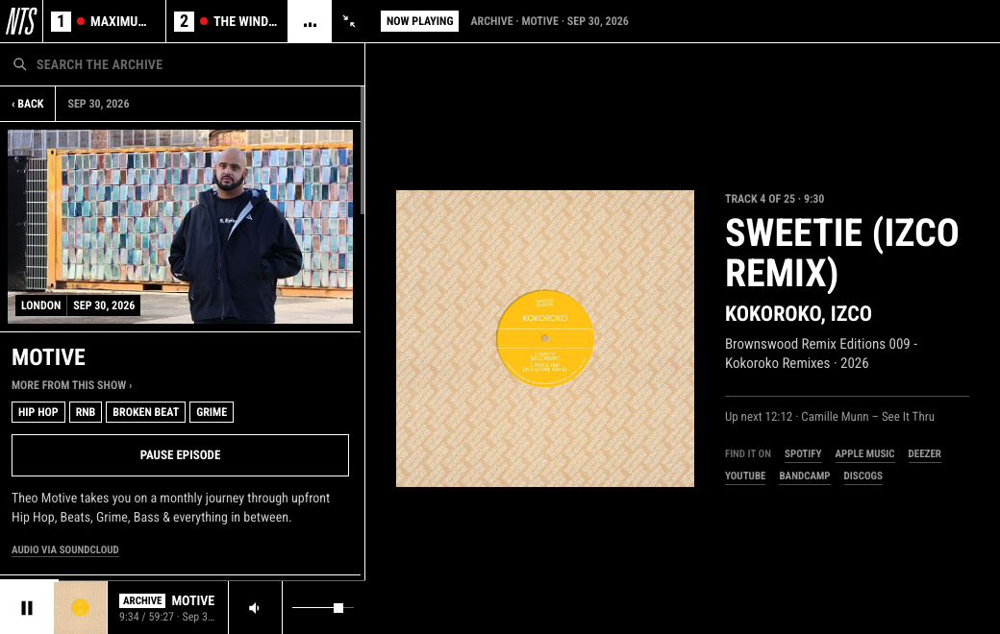

# NTS Player

A small desktop player for [NTS Radio](https://www.nts.live): both live channels and the
archive, in one compact window. Built for Windows, where there's no NTS app, but it runs
anywhere Electron does.

 



## Features

### Live radio

- **NTS 1 and NTS 2**, one click to switch. Show title, artwork, location, time slot,
  genres, description and what's on next.
- **Always live.** Stopping drops the stream, so play picks up what's on air now.
  Reconnects by itself if the stream drops.
- **Live tracklists for NTS Supporters.** In the Tracklist tab, click
  **Sign in for live tracks** and log in on NTS's own sign-in page. The app never sees
  your password, and you stay signed in until you click **Sign out**.
- **Without a Supporter sign-in**, the Tracklist tab shows the show's previous episode.

### Archive

- **Browse and search** every NTS show and episode: recently added, search, and show
  pages with all their episodes.
- **Play episodes** in the app with a seek bar.
- **Tracklists that follow the mix.** The track playing is highlighted; click any track
  to jump to it. Media keys skip between tracks.
- **Track-change notifications** with the album cover (switch off with
  **Notify on track change** above the tracklist).

### History and resume

- **Pick up where you left off.** Open the app and the episode you were playing is
  ready, paused at the same spot.
- **Resume from where you stopped** on any episode you've started, or **Start over**.
- **History** at the top of the archive: episodes with your progress, and live shows
  you heard, so you can find them again later.

### Tracks and artwork

- **Album covers** for tracks in tracklists, the now-playing bar, the Windows media
  overlay and notifications.
- **Click a track** to copy "Artist - Title".

### Wide view

The thin strip is the default. The expand button in the header (or a wider window) adds
a stage with the current track's album art as a record sleeve that tilts toward your
cursor, with a vinyl that spins while the track plays. Below it: title, artist, album,
where the track sits in the mix and what's next, plus links to Spotify, Apple Music,
Deezer, YouTube, Bandcamp and Discogs.

- Deezer and Apple Music open the exact track when it can be found; the others open a
  search ([exact Spotify links](https://github.com/danielsamson/nts-player/issues/1)).
- Spotify, Deezer and Apple Music open in their desktop apps when installed.

### Everywhere

- **Media keys** and the Windows media overlay: play/pause, and next/previous (switches
  channel when live, skips tracks in an episode).
- **Remembers** your channel, volume, view and history.
- **Looks like NTS:** black and white, 1px rules, square corners, bold condensed type,
  the red live dot.

### Keyboard shortcuts

| Key     | Action             |
| ------- | ------------------ |
| `Space` | Play / pause       |
| `1`     | Switch to NTS 1    |
| `2`     | Switch to NTS 2    |
| `Esc`   | Clear the search   |

## Getting started

You need [Node.js](https://nodejs.org) (the LTS version).

```bash
git clone https://github.com/danielsamson/nts-player
cd nts-player
npm install
npm start
```

## Build a Windows .exe

```bash
npm run dist
```

This puts two files in `dist/`:

- `NTS-Player-portable.exe`: a single file you can run directly, no install needed
- `NTS-Player-Setup.exe`: an installer that adds a Start-menu shortcut

The app isn't code-signed, so Windows SmartScreen may warn you the first time you run
it. Click **More info**, then **Run anyway**.

## How it works

| What | Source |
| ---- | ------ |
| Live audio | `stream-relay-geo.ntslive.net/stream` and `/stream2` |
| Now playing, archive, tracklists | The NTS API at `www.nts.live/api/v2/` |
| Archive audio | NTS's SoundCloud uploads, played through SoundCloud's official embed player |
| Live tracklists | `www.nts.live/live-tracklist/{1,2}`, shown in an embedded view (NTS Supporters) |
| Album covers | Deezer (by the track's Deezer ID or ISRC from NTS, or a search), then iTunes Search |
| Apple Music links | iTunes Search, for the track you're listening to |

**Your data stays on your computer.** History, your place in an episode, settings and
the artwork cache are stored locally. Cover and link lookups send only a track's artist
and title (or its ID) to Deezer and Apple.

```
main.js                Window, NTS API access, notifications, sign-in window
art.js                 Album art and Apple Music link lookups, with a local cache
preload.js             The bridge between the window and main.js
src/index.html         Layout
src/renderer.js        Live radio, now-playing bar, history, wide view
src/archive.js         Archive: browse, search, show and episode pages
src/archive-player.js  Plays archive episodes via SoundCloud's embed player
src/style.css          Styling (design tokens at the top)
src/fonts/             Roboto Condensed (SIL Open Font License)
build/icon.png         App icon
```

### Type

nts.live uses Univers Condensed, a commercial typeface that can't be redistributed here.
The app bundles [Roboto Condensed](https://fonts.google.com/specimen/Roboto+Condensed) as
a close, free stand-in, and uses Univers Condensed if you have it installed.

## Disclaimer

This is an unofficial, personal project. It isn't affiliated with or endorsed by NTS
Radio. The NTS name, logo, streams and show content belong to NTS. If you enjoy the
station, consider supporting them through [NTS Supporters](https://www.nts.live/supporters).
