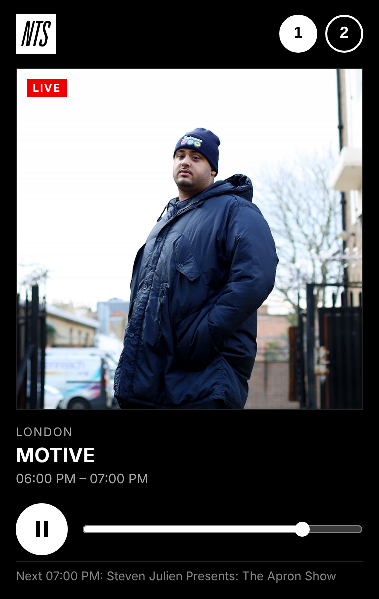
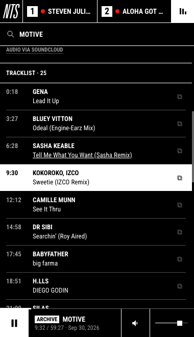

# NTS Player

A small desktop player for [NTS Radio](https://www.nts.live): both live channels and the
archive, in one compact window. Runs on Windows, macOS and Linux.

 


## Features

### Live radio

- **NTS 1 and NTS 2**, one click to switch. Show title, artwork, location, time slot,
  genres, description and what's on next.
- **Always live.** Stopping drops the stream, so play picks up what's on air now.
  Reconnects by itself if the stream drops.
- **Live tracklists for NTS Supporters.** In the Tracklist tab, click
  **Sign in for live tracks** and log in on NTS's own sign-in page. The app never sees
  your password, and you stay signed in until you click **Sign out**.
- **Without a Supporter sign-in**, the Tracklist tab shows the show's previous episode.

### Archive

- **Browse and search** every NTS show and episode: recently added, search, and show
  pages with all their episodes.
- **Play episodes** in the app with a seek bar, and previous / next track buttons.
- **Keep listening.** When an episode ends, the show's previous episode starts (then the
  newest in the archive). Switch it off with **Autoplay next episode** on any episode page.
- **Tracklists that follow the mix.** The track playing is highlighted; click any track
  to jump to it. Media keys skip between tracks.
- **Track-change notifications** with the album cover (switch off with
  **Notify on track change** above the tracklist).

### My NTS

- **Save episodes, follow shows and save tracks** to your NTS account, right from the
  app: the same saves you see on nts.live and in the NTS phone app. Sign in once with
  your NTS account (the app never sees your password).
- **Your saved episodes, followed shows and saved tracks** are in the archive under
  **My NTS**. Click a saved track for its cover, details and links, and to play it in
  the episode you saved it from.
- **Save the track that's playing** from the wide view.

NTS has no public API for this. The app uses NTS's own website, in your signed-in
session, out of sight: it opens the page and presses NTS's own Save / Follow buttons,
and reads your My NTS pages. If NTS changes its site, these buttons may stop working
until the app is updated. To see what's happening, run `npm run debug`: the NTS window
opens next to the player so you can watch it, and each step is logged in the terminal.

### History and resume

- **Pick up where you left off.** Open the app and the episode you were playing is
  ready, paused at the same spot.
- **Resume from where you stopped** on any episode you've started, or **Start over**.
- **History** at the top of the archive: episodes with your progress, and live shows
  you heard, so you can find them again later.

### Tracks and artwork

- **Album covers** for tracks in tracklists, the now-playing bar, the Windows media
  overlay and notifications.
- **Click a track** to copy "Artist - Title".

### Wide view

The thin strip is the default. The expand button in the header (or a wider window) adds
a stage with the current track's album art as a record sleeve that tilts toward your
cursor, with a vinyl that spins while the track plays. Below it: title, artist, album,
where the track sits in the mix and what's next, plus links to Spotify, Apple Music,
Deezer, YouTube, Bandcamp and Discogs.

- Deezer and Apple Music open the exact track when it can be found; the others open a
  search ([exact Spotify links](https://github.com/danielsamson/nts-player/issues/1)).
- Spotify, Deezer and Apple Music open in their desktop apps when installed.

### Everywhere

- **Media keys** and the Windows media overlay: play/pause, and next/previous (switches
  channel when live, skips tracks in an episode).
- **Remembers** your channel, volume, view and history.
- **Looks like NTS:** black and white, 1px rules, square corners, bold condensed type,
  the red live dot.

### Keyboard shortcuts

| Key     | Action             |
| ------- | ------------------ |
| `Space` | Play / pause       |
| `Shift` + `←` / `→` | Previous / next track (archive) |
| `1`     | Switch to NTS 1    |
| `2`     | Switch to NTS 2    |
| `Esc`   | Clear the search   |

## Getting started

You need [Node.js](https://nodejs.org) (the LTS version).

```bash
git clone https://github.com/danielsamson/nts-player
cd nts-player
npm install
npm start
```

## Build the app

```bash
npm run dist
```

This builds for the system you're on and puts the files in `dist/`. To pick one:
`npm run dist:win`, `npm run dist:mac` or `npm run dist:linux`.

| System | Files |
| ------ | ----- |
| Windows | `NTS-Player-portable.exe` (runs directly) and `NTS-Player-Setup.exe` (installer) |
| macOS | `.dmg` and `.zip`, for Apple Silicon (`arm64`) and Intel (`x64`). Build on a Mac. |
| Linux | `.AppImage` (runs on most distributions) and `.deb` (Ubuntu, Debian) |

**Build all three on GitHub:** the **Build** workflow in the Actions tab builds every
version and attaches the files to the run. It also runs when you push a version tag,
like `v1.0.0`.

The builds aren't code-signed, so the first launch needs a click past a warning:

- **Windows:** SmartScreen, click **More info**, then **Run anyway**.
- **macOS:** right-click the app, choose **Open**, then **Open** again.
- **Linux (AppImage):** make it executable first: `chmod +x NTS-Player-*.AppImage`.

## How it works

| What | Source |
| ---- | ------ |
| Live audio | `stream-relay-geo.ntslive.net/stream` and `/stream2` |
| Now playing, archive, tracklists | The NTS API at `www.nts.live/api/v2/` |
| Archive audio | NTS's SoundCloud uploads, played through SoundCloud's official embed player |
| Live tracklists | `www.nts.live/live-tracklist/{1,2}`, shown in an embedded view (NTS Supporters) |
| Album covers | Deezer (by the track's Deezer ID or ISRC from NTS, or a search), then iTunes Search |
| Apple Music links | iTunes Search, for the track you're listening to |
| My NTS | NTS's own pages and buttons on `www.nts.live`, in your signed-in session |

**Your data stays on your computer.** History, your place in an episode, settings and
the artwork cache are stored locally. Cover and link lookups send only a track's artist
and title (or its ID) to Deezer and Apple.

```
main.js                Window, NTS API access, notifications, sign-in window
account.js             My NTS: saves and follows through NTS's own website
art.js                 Album art and Apple Music link lookups, with a local cache
preload.js             The bridge between the window and main.js
src/index.html         Layout
src/renderer.js        Live radio, now-playing bar, history, wide view
src/archive.js         Archive: browse, search, show and episode pages
src/archive-player.js  Plays archive episodes via SoundCloud's embed player
src/style.css          Styling (design tokens at the top)
src/fonts/             Roboto Condensed (SIL Open Font License)
build/icon.png         App icon
```

### Type

nts.live uses Univers Condensed, a commercial typeface that can't be redistributed here.
The app bundles [Roboto Condensed](https://fonts.google.com/specimen/Roboto+Condensed) as
a close, free stand-in, and uses Univers Condensed if you have it installed.

## License

The code is open source under the [MIT License](LICENSE): use it, change it, share it.

That covers this project's code only. The NTS name and logo belong to NTS, and the
bundled Roboto Condensed font is under the SIL Open Font License (`src/fonts/`).

## Disclaimer

This is an unofficial, personal project. It isn't affiliated with or endorsed by NTS
Radio. The NTS name, logo, streams and show content belong to NTS. If you enjoy the
station, consider supporting them through [NTS Supporters](https://www.nts.live/supporters).
